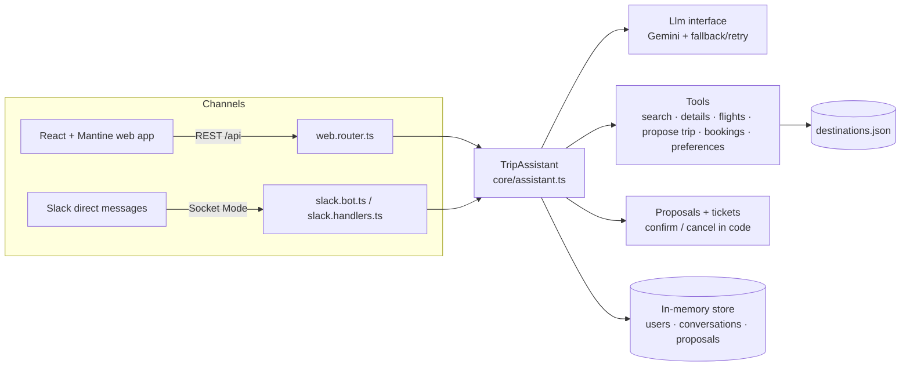

# Travel Assistant: one AI assistant on the web and in Slack

A travel assistant that helps you choose a destination, finds flights and stays, and books a **trip package** in one conversation: you confirm, pay with a saved card, and receive e-tickets and a hotel voucher. The same backend serves a React web app and a Slack bot.

## Try it

| Channel | How |
|---|---|
| **Web** | <https://travel-assistant-caod.onrender.com> |
| **Slack** | Join the workspace with [this invite link](https://join.slack.com/t/the-travel-agent/shared_invite/zt-4hwisjpmt-oVclopSUzLsq5g5LyvcwLQ), then open **Apps → Travel Assistant** and send a direct message. |
| **Demo video** | [Watch the demo](https://github.com/dvora-novogrodski/channels-assistant/releases/download/demo-video/travel-assistant-demo.mp4): both interfaces, a contextual follow-up, a booking, and a failure with recovery ([release page](https://github.com/dvora-novogrodski/channels-assistant/releases/tag/demo-video)) |

Things to try (web or Slack):

1. `I live in Tel Aviv and travel with my partner. Somewhere romantic with beaches in May?` (destination cards; it remembers your airport and group size)
2. Follow up: `What should I pack for the first one?` (general travel knowledge, same conversation)
3. `Book it for 5 nights from May 10 next year with the nicer hotel and the cheapest flight` → choose a card under **Pay with** → **Confirm & pay**. Watch the booking steps, then the e-tickets, hotel voucher and **Add to calendar**.
4. `What have I booked?` (also listed under **My trips** in the sidebar)
5. `simulate failure` shows the failure path with a **Try again** button (enabled on the deployed instance).

In Slack the DM is one continuous chat; press **New trip** (or type `new trip`) to start a fresh conversation, and **My trips** (or type `my trips`) to go back to an earlier one.

The service runs on Render's free tier. If it has been idle, the first request can take about a minute.

## How the requirements are met

| Requirement | Where |
|---|---|
| Real messaging integration with a defined conversation model | Slack over Socket Mode; one flat DM chat per user with explicit **New trip** and **My trips → Continue** actions ([why](#design-decisions)). `server/src/channels/slack.*` |
| React + TypeScript web UI with history and loading / success / error states | Sidebar history, "Planning your trip…" indicator, booking progress, booked state with tickets, error bubbles with **Try again**. `web/src` |
| Shared backend, channel code separated from assistant logic | `server/src/core` knows nothing about Slack or HTTP; channels are thin adapters. |
| Follow-ups and isolated users | History per conversation, bookings per user, ownership checked on every read (`store.ts`). In-memory storage, limits documented below. |
| LLM with tools | Gemini with six tools: search destinations, destination details, search flights, propose trip, list bookings, save preferences (`tools.ts`). |
| Graceful LLM / tool / delivery failures | LLM errors become chat messages with a retry; tool errors go back to the model; a Slack message Slack rejects is replaced by a clear notice. |
| Focused tests | 138 Vitest tests, including isolation, follow-up context, failures and duplicate events (see [Tests](#tests)). |
| Nice-to-haves | **Clear action confirmation** (proposal → confirm/cancel → booked, proposed vs completed clearly different) and **channel-native interactions** (cards, buttons, quick replies, text fallback "confirm"). |

## What it does

- **Search and compare** curated destinations by month, region, budget, travel style and trip length, including cheapest first. Results appear as destination cards with **Plan this trip**.
- **Flights and stays.** Round-trip flight offers per route and date, with a prefilled Google Flights link to compare prices; two hand-picked stays per destination.
- **Trip packages.** Flight + stay with a cost breakdown. All prices are computed in code (nightly rate × nights × rooms, fare × travelers), never by the model.
- **Propose, then confirm and pay.** Nothing is booked until the user confirms with the card button, a quick-reply chip, or by typing `confirm`. Payment uses a saved card chosen under **Pay with**.
- **Booking that feels complete.** Booking steps (seats, hotel, payment, tickets), then a booking reference, airline booking code, e-ticket per traveler, seats, outbound and return legs, hotel voucher with check-in/out, and a downloadable calendar file.
- **Freedom with grounding.** General travel questions (packing, food, itineraries) are answered from the model's knowledge; anything bookable or priced comes only from tools.
- **Remembers preferences** (home airport, group size, budget style, interests) across chats.
- **Quick replies** after each answer, as chips on the web and buttons in Slack.

## Architecture



```
shared/            Types shared by server and web (API contract, destination schema, saved cards)
server/
  src/core/        Channel-agnostic logic: assistant loop, tools, proposals, tickets, store, LLM
  src/channels/    Thin adapters: web.router.ts (Express), slack.* (Bolt, Block Kit)
  src/http/        Central Express error middleware
  data/            Destination catalog
  test/            Vitest suites with a scripted fake LLM (no network)
web/               React + TypeScript + Mantine chat UI
docs/              Decision log, Slack setup, deployment
```

`core/` never imports a channel. Channels talk to core only through `TravelService` (`core/travelService.ts`), so adding a channel means one adapter that turns platform events into `service.sendMessage(userId, conversationId, text)` and `service.resolveProposal(...)` calls. The store hands out copies and saves each turn or decision in a single `commit`, so a database can replace it without changing the assistant.

**Start reading the code with [docs/decisions.md](docs/decisions.md)**: it lists the files in reading order and the reasoning behind every major decision.

## Design decisions

The full decision log is in [docs/decisions.md](docs/decisions.md). The most important ones:

**Slack as one flat chat with "New trip".** Slack is free (no SMS verification), familiar to reviewers, and Socket Mode needs no public webhook. The DM works like messaging a person: every message continues the current trip, and replies appear in the main chat. **New trip** (button or text) starts a fresh conversation. I first used one thread per conversation, but replies hidden in threads were clunky and a follow-up typed outside the thread silently started a new chat. Threads had one real advantage, going back to an earlier trip, so the flat chat adds **My trips**: it lists your trips with a **Continue** button, and continuing one makes it the current trip again with its full history.

**Users and conversations are separate.** Bookings and preferences belong to the user (`web:<uuid>` or `slack:<user id>`); LLM history belongs to the conversation. Every read checks ownership, and "missing" and "not yours" return the same 404.

**A turn is saved only when it fully succeeds.** The tool loop (capped at 6 steps) runs on a copy of the history; tool side effects (proposals, preferences) are collected and applied only after every LLM call succeeds, so a failure leaves nothing half-written and a retry is clean.

**Confirmation happens in code, not in the LLM.** Confirm and cancel never call the model, are idempotent (a double click or Slack retry books once), and a cancelled or replaced proposal can't be booked.

**Saved cards instead of a card form.** A public app with a card form invites real card numbers, and an LLM should never handle payment data. Choosing from saved cards is how booking apps work after the first purchase.

**Failures are chat messages.** An LLM outage returns HTTP 200 with `reply.error = { kind, retryable }`; the UI explains what happened and offers **Try again**. HTTP 4xx/5xx are reserved for API misuse.

**Free-tier reliability.** Each LLM call tries the primary Gemini model, a second model, then the primary again after 1.5 s. Overlapping messages in one conversation get a "still working" reply instead of racing.

## Run locally

Requirements: Node 22.15+ and a free Gemini API key from <https://aistudio.google.com/apikey>.

```powershell
npm install
Copy-Item .env.example .env   # then set GEMINI_API_KEY (Slack tokens are optional)
npm run dev:server            # API + Slack bot on http://localhost:3000
npm run dev:web               # React dev server on http://localhost:5173 (proxies /api)
```

Production-style: `npm run build`, then `npm start`. This serves the built web app from the API server.

| Script | Purpose |
|---|---|
| `npm test` | Vitest suites (138 tests, no network) |
| `npm run typecheck` | Strict TypeScript across all workspaces |
| `npm run smoke:gemini -w server` | One real Gemini tool-call round trip |
| `npm run smoke:assistant -w server` | A real multi-turn conversation through the assistant |

- **Slack:** [docs/slack-setup.md](docs/slack-setup.md) (app manifest, tokens, conversation model).
- **Deployment:** [docs/deploy.md](docs/deploy.md) (Render Blueprint, keep-awake ping).
- **Behind HTTPS-inspecting filters** (for example Netspark): local scripts pass `--use-system-ca` so Node trusts the Windows certificate store.

## Tests

| Suite | Covers |
|---|---|
| `assistant.test.ts` | Follow-up context, LLM failure saves nothing and recovers, rate limits, tool failure fed back, no orphan proposal on failure, supersede, busy rejection, step cap, history window, preferences, quick replies, destination cards |
| `proposals.test.ts` | Booking only after confirmation, idempotent double confirm, cancel, replaced proposals can't be booked, ownership, typed `confirm`, chosen payment card |
| `tickets.test.ts` | E-tickets and seats per traveler, overnight arrivals, return flight after check-out, hotel voucher |
| `store.test.ts`, `seenEvents.test.ts` | Conversation isolation between users, bookings per user, titles, single commit, reads return copies, duplicate-event set |
| `slack.test.ts` | Flat chat, New trip and My trips → Continue, duplicate events and clicks processed once, card updates and booking progress, delivery-failure notice, long-reply splitting, mrkdwn escaping, token validation |
| `webApi.test.ts` | Real HTTP: per-user lists, bookings, 400/404/malformed JSON, LLM failure as a chat message, SPA fallback |
| `gemini.test.ts`, `tools.test.ts`, `destinations.test.ts` | Message and error mapping, fallback/retry, tool validation, flights, packages, search filters and sorting |

## Known limitations

- **Sample data and simulated bookings.** The destination catalog, stays, flights, tickets and payments are generated for this assignment; nothing is reserved or charged. The only real external link is the Google Flights price comparison.
- **In-memory storage.** Conversations, proposals and bookings are lost on restart; one process only; the LLM sees the last 24 messages; the duplicate-event set keeps the last 1,000 keys.
- **No authentication.** A web user is a random id in `localStorage`, so another browser is a new user. Web and Slack identities are not linked.
- **Time zones.** Flight arrival times and calendar events use the departure time zone.
- **Free tiers.** Gemini can be slow or briefly unavailable (the app retries, then shows a retryable error). Render's free instance may restart and needs an uptime ping to stay awake.
- **Slack.** The current trip per DM is kept in memory, so a restart starts a new conversation and old buttons answer "no longer available". The invite link expires after 30 days.
- **Overlapping messages** in one conversation are rejected rather than queued.

## What I would improve with more time

1. **Real data, saved in a database.** Replace the sample catalog and generated flights, stays and tickets with real travel data from flight and hotel providers, behind the same tool interfaces and with time-zone-aware schedules. Save users, conversations, preferences and bookings in a database, so nothing is lost on a restart and the service can run on more than one instance. The store already saves each turn or decision in a single `commit`, which maps to one database transaction.
2. **Real users.** Sign-in instead of a random browser id, so the same person sees their trips on any device. Link a web account and a Slack user, so a trip started in one channel can continue in the other.
3. **Streaming:** stream answers and tool progress to the web UI, with a cancel button.
4. **Interruptions:** let a new message cancel or amend the running turn instead of "still working".
5. **Quality and operations:** an eval set for tool choice and answers, a paid LLM tier or provider failover, per-user rate limits, structured logs.
6. **End-to-end tests** with Playwright.

## Tech

TypeScript · Node 22 · Express 5 · Slack Bolt (Socket Mode) · Google Gemini (`@google/genai`) · zod · React 19 · Mantine 8 · Vite · Vitest · Render
