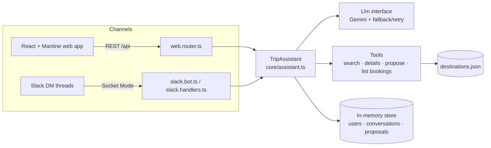

# Travel Assistant: one AI assistant on the web and in Slack

A small travel assistant that suggests destinations from a local catalog and prepares **simulated stay bookings** that the user must confirm. The same backend serves a React web app and a Slack bot.

## Try it

| Channel | How |
|---|---|
| **Web** | <https://travel-assistant-caod.onrender.com> |
| **Slack** | Join the workspace with [this invite link](https://join.slack.com/t/the-travel-agent/shared_invite/zt-4hwisjpmt-oVclopSUzLsq5g5LyvcwLQ), then open **Apps → Travel Assistant** and send a direct message. |
| **Demo video** | _link to be added_ |

Things to try:

1. `Somewhere warm with beaches in February`
2. Follow up: `Tell me more about the first one`
3. `Book it for 2 people, 4 nights from March 3 next year`, then press **Confirm stay** (or reply `confirm`)
4. `What have I booked?`
5. `simulate failure` shows the error path (enabled on the deployed instance)

The service runs on Render's free tier. If it has been idle, the first request can take about a minute.

## What it does

- **Search and inspect** 32 curated destinations by month, region, budget, travel style and trip length, including "cheapest first".
- **Follow-up context** within a conversation: "the first one", "make it 3 nights".
- **Propose, then confirm.** The assistant can only *propose* a stay. Nothing is booked until the user confirms with a button or by typing `confirm`. Proposals clearly show *proposed*, *booked*, *cancelled* or *replaced* on both channels.
- **Stay only.** Bookings cover accommodation and an estimate of daily costs. Flights are explicitly out of scope, and the assistant says so.

## Architecture



```
shared/            Types shared by server and web (API contract, destination schema)
server/
  src/core/        Channel-agnostic logic: assistant loop, tools, proposals, store, LLM
  src/channels/    Thin adapters: web.router.ts (Express), slack.* (Bolt, Block Kit)
  src/http/        Central Express error middleware
  data/            Destination catalog (sample data)
  test/            Vitest suites with a scripted fake LLM (no network)
web/               React + TypeScript + Mantine chat UI
docs/              Slack setup and deployment guides
```

`core/` never imports a channel. Adding a channel means adding one adapter that turns platform events into `assistant.handleMessage(userId, conversationId, text)` and `assistant.resolveProposal(...)` calls.

## Design decisions

**Slack, with one thread per conversation.** Slack is free (no SMS verification) and familiar to reviewers. Socket Mode means no public webhook or request signing, and it supports buttons. Each new direct message starts a conversation, and the bot answers in a thread. Replies in that thread are follow-ups, and the DM's thread list is the history. This gives Slack a native "new chat" and "history" without commands. The trade-off is that a follow-up written outside the thread starts a new chat, so the first reply in every thread says so.

**Users and conversations are separate.** Bookings belong to the user (`web:<uuid>` or `slack:<user id>`), so they are visible from any chat. LLM history belongs to the conversation. Every read checks ownership, and an unknown id and someone else's id return the same 404, so ids cannot be probed.

**The tool loop saves a turn only when it fully succeeds.** `TripAssistant` runs a capped (5-step) tool loop on a *copy* of the history. Tool side effects (a new proposal) are collected as *effects* and applied only after every LLM call succeeds. A failure mid-turn leaves no half-written history, no orphan proposal and no unsaved user message, so a retry is clean.

**Proposals are resolved in code, not by the LLM.** Confirm and cancel (button or typed `confirm` / `cancel`) skip the model. They are idempotent (a double click or Slack retry books once), a cancelled or replaced proposal cannot be booked, and the outcome is added to the LLM history so follow-ups know about it. **Prices are computed in code** (daily cost × nights × travelers), never written by the model.

**zod at every boundary.** One schema per tool gives Gemini its JSON Schema and validates the model's arguments. Invalid arguments are returned to the model as tool errors, so it can correct itself. HTTP bodies, env config (including Slack token prefixes) and the dataset are validated the same way.

**A small LLM interface instead of a framework.** `Llm.generate()` uses provider-neutral messages, and only `gemini.ts` imports the SDK. Gemini's raw response parts (thought signatures) are kept and sent back unchanged. Tests use a scripted fake LLM.

**Failures are chat messages, not HTTP errors.** An LLM outage returns HTTP 200 with `reply.error = { kind, retryable }`, and the UI shows a specific message and a **Retry** button. HTTP 400/404/413/500 are reserved for misuse of the API and handled in one Express error middleware.

**Free-tier reliability.** Gemini's free tier often returns 503/504. Each call tries the primary model, then a second lite model (load is per model), then the primary again after 1.5 s. Overlapping messages in one conversation are rejected with a "still working" reply instead of racing.

**Slack details.** A "_Checking destinations…_" placeholder is replaced by the answer. Markdown is converted to Slack mrkdwn. Proposal cards are Block Kit with a plain-text fallback, and they are edited in place when confirmed, cancelled or replaced. Duplicate events are ignored by `channel:ts`. Slack delivery failures are logged without losing the turn.

## Run locally

Requirements: Node 22.15+ and a free Gemini API key from <https://aistudio.google.com/apikey>.

```powershell
npm install
Copy-Item .env.example .env   # then set GEMINI_API_KEY (Slack tokens are optional)
npm run dev:server            # API + Slack bot on http://localhost:3000
npm run dev:web               # React dev server on http://localhost:5173 (proxies /api)
```

Production-style: `npm run build`, then `npm start`. This serves the built web app from the API server.

| Script | Purpose |
|---|---|
| `npm test` | Vitest suites (101 tests, no network) |
| `npm run typecheck` | Strict TypeScript across all workspaces |
| `npm run smoke:gemini -w server` | One real Gemini tool-call round trip |
| `npm run smoke:assistant -w server` | A real multi-turn conversation through the assistant |

- **Slack:** see [docs/slack-setup.md](docs/slack-setup.md) (app manifest, tokens, conversation model).
- **Deployment:** see [docs/deploy.md](docs/deploy.md) (Render Blueprint, keep-awake ping).
- **Behind HTTPS-inspecting filters** (for example Netspark): local scripts pass `--use-system-ca` so Node trusts the Windows certificate store.

## Tests

| Suite | Covers |
|---|---|
| `assistant.test.ts` | Follow-up context, LLM failure saves nothing and recovers, rate limits, tool failure fed back, no orphan proposal on failure, supersede, busy rejection, step cap, history window |
| `proposals.test.ts` | Confirm only after confirmation, idempotent double confirm, cancel, superseded cannot be booked, ownership, typed `confirm` without an LLM call |
| `store.test.ts` | Conversation isolation between users, bookings per user, titles, duplicate-event set |
| `slack.test.ts` | Thread-per-conversation, duplicate events processed once, ignored message types, card updates, one outcome per double click, delivery failures, mrkdwn, token validation |
| `webApi.test.ts` | Real HTTP: per-user lists, 400/404/malformed JSON, LLM failure as a chat message, SPA fallback |
| `gemini.test.ts`, `tools.test.ts`, `destinations.test.ts` | Message mapping, error mapping, fallback/retry, tool validation, search filters and sorting |

## Known limitations

- **In-memory storage.** Conversations, proposals and bookings are lost on restart, there is one process only (no horizontal scaling), and memory grows with use. The LLM sees the last 20 messages, and the duplicate-event set keeps the last 1,000 keys.
- **No authentication.** A web user is a random id in `localStorage`, so another browser means a new user. Web and Slack identities are not linked.
- **Sample data and simulated bookings.** 32 hand-curated destinations with rough daily costs. Stays only, no flights, no payments.
- **Free tiers.** Gemini can be slow or briefly unavailable, and the app shows a retryable error after retries. Render's free instance may restart (clearing memory) and needs an uptime ping to stay awake.
- **Slack.** Proposal-card references are in memory, so after a restart old buttons answer "no longer available". The workspace invite link expires after 30 days.
- **Overlapping messages** in one conversation are rejected rather than queued or merged.

## What I would improve with more time

1. **Persistence:** SQLite or Postgres behind the existing `ConversationStore` interface, which would remove most of the limitations above.
2. **Conversation handoff:** link a web user and a Slack user with a one-time code, so a chat can continue across channels.
3. **Flight search links:** a tool that builds prefilled flight-search links for the trip dates (no fake prices, no real booking).
4. **Streaming and progress:** stream tokens to the web UI and show tool progress ("searching…"), with a cancel button.
5. **Interruptions:** let a new message cancel or amend the running turn instead of getting "still working".
6. **Reliability and quality:** a paid LLM tier or provider failover, an eval set for tool choice and answer quality, per-user rate limits, and structured logs.
7. **End-to-end tests** with Playwright for the web UI.

## Tech

TypeScript · Node 22 · Express 5 · Slack Bolt (Socket Mode) · Google Gemini (`@google/genai`) · zod · React 19 · Mantine 8 · Vite · Vitest · Render
