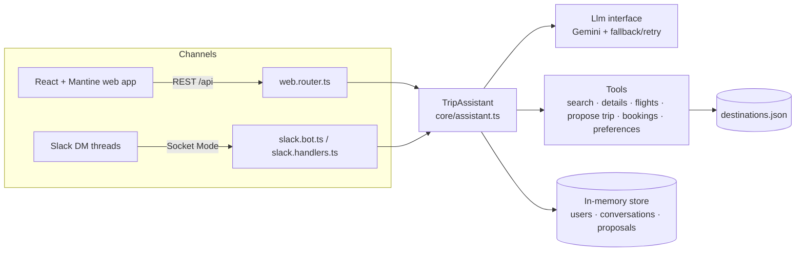

# Travel Assistant: one AI assistant on the web and in Slack

A travel assistant that suggests destinations from a local catalog, finds demo flights and stays, and prepares a **trip package** (flight + stay) that the user confirms and "pays" for with a demo card on file. The same backend serves a React web app and a Slack bot.

## Try it

| Channel | How |
|---|---|
| **Web** | <https://travel-assistant-caod.onrender.com> |
| **Slack** | Join the workspace with [this invite link](https://join.slack.com/t/the-travel-agent/shared_invite/zt-4hwisjpmt-oVclopSUzLsq5g5LyvcwLQ), then open **Apps → Travel Assistant** and send a direct message. |
| **Demo video** | _link to be added_ |

Things to try:

1. `I live in Tel Aviv and travel with my partner. Somewhere romantic with beaches in May?` (it remembers your airport and group size)
2. Follow up: `What should I pack for the first one?` (general travel knowledge)
3. `Book it for 5 nights from May 10 next year with the nicer hotel and the cheapest flight`, then press **Confirm & pay** (or tap the `Confirm trip` chip, or reply `confirm`)
4. `What have I booked?`
5. `simulate failure` shows the error path (enabled on the deployed instance)

The service runs on Render's free tier. If it has been idle, the first request can take about a minute.

## What it does

- **Search and inspect** 32 curated destinations by month, region, budget, travel style and trip length, including "cheapest first". Each has an airport and two fictional stays.
- **Demo flights + real prices.** `search_flights` returns simulated round-trip offers (deterministic per route and date), always with a prefilled **Google Flights link** to compare real prices.
- **Trip packages.** `propose_trip` combines a stay and an optional flight. All prices are computed in code (nightly rate × nights × rooms, fare × travelers).
- **Propose, then confirm and pay.** Nothing is booked until the user confirms with the card button, a quick-reply chip, or by typing `confirm`. Payment uses a **demo card on file** (Visa •••• 4242). No card details are ever entered, and the model never sees payment data. Cards show *ready to book*, *booked*, *cancelled* or *replaced* on both channels.
- **More freedom, still grounded.** The assistant answers general travel questions (itineraries, packing, food, culture) from its own knowledge. Anything bookable or priced comes only from tools.
- **Remembers preferences** (home airport, group size, budget style, interests) across chats.
- **Quick replies.** Each answer suggests 2–3 follow-ups, shown as chips on the web and buttons in Slack.

## Architecture



```
shared/            Types shared by server and web (API contract, destination schema)
server/
  src/core/        Channel-agnostic logic: assistant loop, tools, proposals, store, LLM
  src/channels/    Thin adapters: web.router.ts (Express), slack.* (Bolt, Block Kit)
  src/http/        Central Express error middleware
  data/            Destination catalog (sample data)
  test/            Vitest suites with a scripted fake LLM (no network)
web/               React + TypeScript + Mantine chat UI
docs/              Slack setup and deployment guides
```

`core/` never imports a channel. Adding a channel means adding one adapter that turns platform events into `assistant.handleMessage(userId, conversationId, text)` and `assistant.resolveProposal(...)` calls.

## Design decisions

**Slack, with one thread per conversation.** Slack is free (no SMS verification) and familiar to reviewers. Socket Mode means no public webhook or request signing, and it supports buttons. Each new direct message starts a conversation, and the bot answers in a thread. Replies in that thread are follow-ups, and the DM's thread list is the history. This gives Slack a native "new chat" and "history" without commands. The trade-off is that a follow-up written outside the thread starts a new chat, so the first reply in every thread says so.

**Users and conversations are separate.** Bookings belong to the user (`web:<uuid>` or `slack:<user id>`), so they are visible from any chat. LLM history belongs to the conversation. Every read checks ownership, and an unknown id and someone else's id return the same 404, so ids cannot be probed.

**The tool loop saves a turn only when it fully succeeds.** `TripAssistant` runs a capped (5-step) tool loop on a *copy* of the history. Tool side effects (a new proposal) are collected as *effects* and applied only after every LLM call succeeds. A failure mid-turn leaves no half-written history, no orphan proposal and no unsaved user message, so a retry is clean.

**Proposals are resolved in code, not by the LLM.** Confirm and cancel (button or typed `confirm` / `cancel`) skip the model. They are idempotent (a double click or Slack retry books once), a cancelled or replaced proposal cannot be booked, and the outcome is added to the LLM history so follow-ups know about it. **Prices are computed in code** (nightly rate × nights × rooms, fare × travelers), never written by the model.

**Demo payment instead of a card form.** Confirming "pays" with a demo card on file. A card-entry form in a public demo invites real card numbers, and an LLM should never handle payment data, so the wallet gives the realistic flow without collecting anything.

**Demo flights are deterministic.** Offers are derived from a hash of route and date, so `propose_trip` can re-create the offer the user picked without storing search results, and every offer links to real prices on Google Flights.

**Freedom with grounding.** The prompt lets the model use general travel knowledge but requires tools for anything bookable or priced. Preferences and proposals are tool *effects*, applied only when the whole turn succeeds.

**Quick replies** are requested as a final `Quick replies: a | b | c` line, parsed out of the text on the server and rendered as chips (web) or buttons (Slack). A reply without the line simply has no chips.

**zod at every boundary.** One schema per tool gives Gemini its JSON Schema and validates the model's arguments. Invalid arguments are returned to the model as tool errors, so it can correct itself. HTTP bodies, env config (including Slack token prefixes) and the dataset are validated the same way.

**A small LLM interface instead of a framework.** `Llm.generate()` uses provider-neutral messages, and only `gemini.ts` imports the SDK. Gemini's raw response parts (thought signatures) are kept and sent back unchanged. Tests use a scripted fake LLM.

**Failures are chat messages, not HTTP errors.** An LLM outage returns HTTP 200 with `reply.error = { kind, retryable }`, and the UI shows a specific message and a **Retry** button. HTTP 400/404/413/500 are reserved for misuse of the API and handled in one Express error middleware.

**Free-tier reliability.** Gemini's free tier often returns 503/504. Each call tries the primary model, then a second lite model (load is per model), then the primary again after 1.5 s. Overlapping messages in one conversation are rejected with a "still working" reply instead of racing.

**Slack details.** A "_Checking destinations…_" placeholder is replaced by the answer. Markdown is converted to Slack mrkdwn. Proposal cards are Block Kit with a plain-text fallback, and they are edited in place when confirmed, cancelled or replaced. Duplicate events are ignored by `channel:ts`. Slack delivery failures are logged without losing the turn.

## Run locally

Requirements: Node 22.15+ and a free Gemini API key from <https://aistudio.google.com/apikey>.

```powershell
npm install
Copy-Item .env.example .env   # then set GEMINI_API_KEY (Slack tokens are optional)
npm run dev:server            # API + Slack bot on http://localhost:3000
npm run dev:web               # React dev server on http://localhost:5173 (proxies /api)
```

Production-style: `npm run build`, then `npm start`. This serves the built web app from the API server.

| Script | Purpose |
|---|---|
| `npm test` | Vitest suites (115 tests, no network) |
| `npm run typecheck` | Strict TypeScript across all workspaces |
| `npm run smoke:gemini -w server` | One real Gemini tool-call round trip |
| `npm run smoke:assistant -w server` | A real multi-turn conversation through the assistant |

- **Slack:** see [docs/slack-setup.md](docs/slack-setup.md) (app manifest, tokens, conversation model).
- **Deployment:** see [docs/deploy.md](docs/deploy.md) (Render Blueprint, keep-awake ping).
- **Behind HTTPS-inspecting filters** (for example Netspark): local scripts pass `--use-system-ca` so Node trusts the Windows certificate store.

## Tests

| Suite | Covers |
|---|---|
| `assistant.test.ts` | Follow-up context, LLM failure saves nothing and recovers, rate limits, tool failure fed back, no orphan proposal on failure, supersede, busy rejection, step cap, history window |
| `proposals.test.ts` | Confirm only after confirmation, idempotent double confirm, cancel, superseded cannot be booked, ownership, typed `confirm` without an LLM call |
| `store.test.ts` | Conversation isolation between users, bookings per user, titles, duplicate-event set |
| `slack.test.ts` | Thread-per-conversation, duplicate events processed once, ignored message types, card updates, one outcome per double click, delivery failures, mrkdwn, token validation |
| `webApi.test.ts` | Real HTTP: per-user lists, 400/404/malformed JSON, LLM failure as a chat message, SPA fallback |
| `gemini.test.ts`, `tools.test.ts`, `destinations.test.ts` | Message mapping, error mapping, fallback/retry, tool validation, search filters and sorting |

## Known limitations

- **In-memory storage.** Conversations, proposals and bookings are lost on restart, there is one process only (no horizontal scaling), and memory grows with use. The LLM sees the last 20 messages, and the duplicate-event set keeps the last 1,000 keys.
- **No authentication.** A web user is a random id in `localStorage`, so another browser means a new user. Web and Slack identities are not linked.
- **Sample data and simulated bookings.** 32 hand-curated destinations with fictional stays and rough daily costs. Flights are simulated (with links to real prices). Payment is a demo card; nothing is charged or reserved.
- **Free tiers.** Gemini can be slow or briefly unavailable, and the app shows a retryable error after retries. Render's free instance may restart (clearing memory) and needs an uptime ping to stay awake.
- **Slack.** Proposal-card references are in memory, so after a restart old buttons answer "no longer available". The workspace invite link expires after 30 days.
- **Overlapping messages** in one conversation are rejected rather than queued or merged.

## What I would improve with more time

1. **Persistence:** SQLite or Postgres behind the existing `ConversationStore` interface, which would remove most of the limitations above.
2. **Conversation handoff:** link a web user and a Slack user with a one-time code, so a chat can continue across channels.
3. **Real inventory:** swap the deterministic demo flights and catalog for real flight and hotel APIs behind the same tool interfaces.
4. **Streaming and progress:** stream tokens to the web UI and show tool progress ("searching…"), with a cancel button.
5. **Interruptions:** let a new message cancel or amend the running turn instead of getting "still working".
6. **Reliability and quality:** a paid LLM tier or provider failover, an eval set for tool choice and answer quality, per-user rate limits, and structured logs.
7. **End-to-end tests** with Playwright for the web UI.

## Tech

TypeScript · Node 22 · Express 5 · Slack Bolt (Socket Mode) · Google Gemini (`@google/genai`) · zod · React 19 · Mantine 8 · Vite · Vitest · Render
